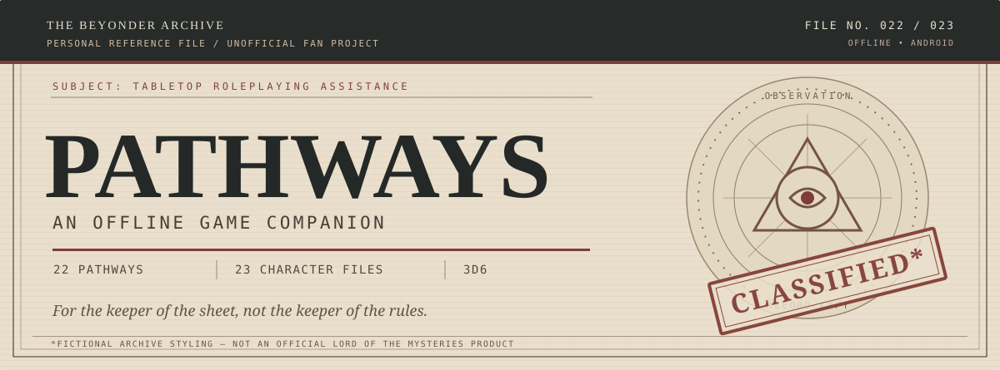
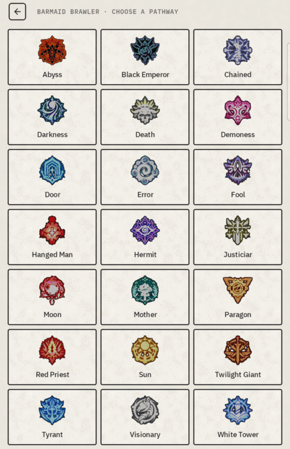
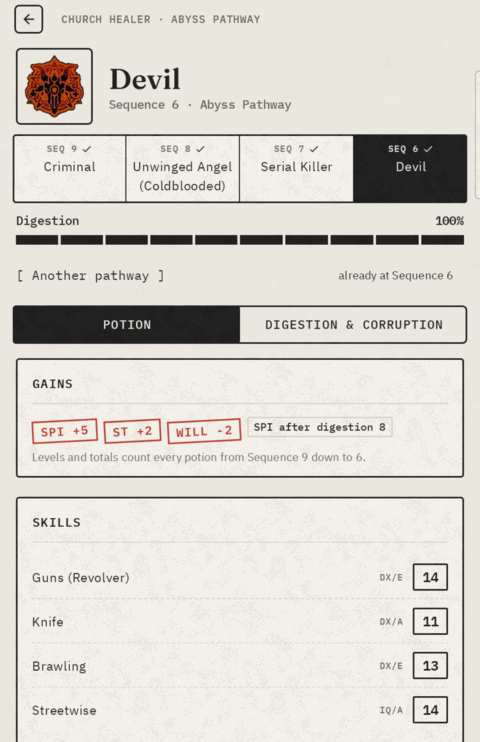
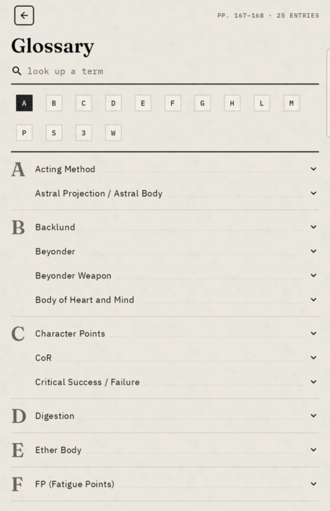

<p align="center">
  
</p>

<p align="center">
  <strong>OFFLINE ANDROID COMPANION</strong> &nbsp;·&nbsp; 22 PATHWAYS &nbsp;·&nbsp; 23 CHARACTER FILES &nbsp;·&nbsp; NO ANDROID PERMISSIONS
</p>

<p align="center">
  <a href="#case-brief">Case brief</a> &nbsp;·&nbsp;
  <a href="#evidence-board">Evidence board</a> &nbsp;·&nbsp;
  <a href="#field-reports">Field reports</a> &nbsp;·&nbsp;
  <a href="#deployment-notes">Build &amp; run</a> &nbsp;·&nbsp;
  <a href="#provenance--credits">Credits</a>
</p>

---

<sub>FILE 01 &nbsp; / &nbsp; SUBJECT PROFILE</sub>

## Case brief

**Pathways** is an offline Android companion for the *Lord of the Mysteries* tabletop RPG. It keeps the character sheet, the dice, and the rule arithmetic together, so players can stay at the table instead of stopping to look up numbers.

The game itself is **not** part of this project. Pathways is a personal, non-commercial companion to *Powered by GURPS: Pathways, Lord of the Mysteries* (v6.9i), designed and written by **Earvin Salonoy**, with the **Mr.Worm's LOM TTRPG Discord Server** as scribes. The rules build on **GURPS 4th Edition**.

> **Governing principle:** The app adds no rules of its own. Every roll shows its target and modifiers. Decisions left to the GM remain with the GM.

| RECORD | CONTENTS |
|:--|:--|
| **Character registry** | Open any of 23 published characters, or create your own. |
| **Dice office** | Resolve skills, attacks, defenses, Fright Checks, rituals, divination and prayers with 3d6. |
| **Condition ledger** | Track HP, FP, Spirituality (SPI) and Corruption, including their relevant penalties. |
| **Potion archive** | Follow a pathway one Sequence at a time; track digestion and resolve the Potion Consumption Roll. |
| **Acquisition desk** | Build attributes, skills, advantages, disadvantages, languages and weapons against a live point budget. |
| **Operating conditions** | No network required. No Android permissions requested. |

---

<sub>FILE 02 &nbsp; / &nbsp; VISUAL EVIDENCE</sub>

## Evidence board

Three views from the application: the character registry, the skills ledger, and the pathway index.

<table>
  <tr>
    <td align="center" width="33%"></td>
    <td align="center" width="33%"></td>
    <td align="center" width="33%"></td>
  </tr>
  <tr>
    <td align="center"><sub>EXHIBIT A · CHARACTER REGISTRY</sub></td>
    <td align="center"><sub>EXHIBIT B · SKILLS LEDGER</sub></td>
    <td align="center"><sub>EXHIBIT C · PATHWAY INDEX</sub></td>
  </tr>
</table>

---

<sub>FILE 03 &nbsp; / &nbsp; RECORDED FIELD ACTIVITY</sub>

## Field reports

The following recordings were captured on a **Samsung Galaxy Tab Active3**, using the **Church Healer**, a **Sequence 6 Beyonder on the Abyss pathway**.

### Incident 01 — Diagnosis under pressure

The GM rules that the healer is distracted. You select **Diagnosis**, apply *Distracted or hurried −2*, and the target changes from **13 to 11** before the roll. The result displays all three dice, the margin, and the modifiers used.

<p align="center"></p>

### Incident 02 — Revolver fire

Select **Attack**, then *Guns (Revolver)*. The app assembles the weapon, maneuver, range and target. On a hit, **Roll damage** throws the revolver's **2d**.

<p align="center"></p>

### Incident 03 — Potion-derived abilities

Open **Pathway** to see each potion's grants: attributes, skills, advantages and abilities. Abilities appear as compact entries with cost tags; select one to read its rulebook text.

<p align="center"></p>

---

<sub>FILE 04 &nbsp; / &nbsp; SUPPLEMENTARY EVIDENCE</sub>

## Further exhibits

<table>
  <tr>
    <td width="33%" align="center"></td>
    <td width="33%" align="center"></td>
    <td width="33%" align="center"></td>
  </tr>
  <tr>
    <td align="center"><strong>VITALS</strong><br><sub>HP, FP, SPI and available actions</sub></td>
    <td align="center"><strong>TRAITS</strong><br><sub>Advantages and applied-rule tags</sub></td>
    <td align="center"><strong>DEFENSE</strong><br><sub>Dodge, Parry and Block</sub></td>
  </tr>
  <tr>
    <td align="center"></td>
    <td align="center"></td>
    <td align="center"></td>
  </tr>
  <tr>
    <td align="center"><strong>PATHWAY</strong><br><sub>Four Sequences and digestion</sub></td>
    <td align="center"><strong>BUILDER</strong><br><sub>Point allocation and live budget</sub></td>
    <td align="center"><strong>GLOSSARY</strong><br><sub>Rulebook terminology</sub></td>
  </tr>
</table>

---

<sub>FILE 05 &nbsp; / &nbsp; FIELD INSTRUCTIONS</sub>

## Operating procedure

The [player guide](docs/HOW-TO-PLAY.md) explains every screen and roll, including decisions that **only the player or GM** can make. It also documents the few ambiguous rulebook passages for which the app must choose an interpretation.

<sub>FILE 06 &nbsp; / &nbsp; TECHNICAL ANNEX</sub>

## Deployment notes

**Requirements:** Android **8.0 (API 26)** or later, **JDK 17**, and Android Studio or the Android SDK for building.

1. Clone this repository.
2. Connect an Android device with USB/wireless debugging, or start an emulator.
3. Install the debug application:

```bash
./gradlew :app:installDebug
```

To run the checks:

```bash
./gradlew test              # Kotlin tests, all modules
py -m pytest tools -q       # Python extractor tests (use `python` outside Windows)
```

Python tests need only `pytest`. Tests that use the rulebook PDF or source spreadsheets skip when those files are absent. To run the extraction tools themselves, install `pypdf` and `openpyxl`.

<details>
<summary><strong>Repository inventory</strong> — modules and data sources</summary>

| LOCATION | PURPOSE |
|:--|:--|
| `core/model` | Plain data types: attributes, skills, traits and characters. |
| `core/rules` | Rules engine and the book's tables, stored as JSON under `src/main/resources/content/`. |
| `app` | Jetpack Compose Android interface. |
| `fixtures` | The 23 published character sheets as JSON, used to check rule behavior. |
| `tools` | Python extractors for tables from the rulebook PDF. |
| `docs` | Player guide, design specification and development log. |

The rule tables are included in the repository: **the PDF is not required to build the app**. It is only required to run the extractors again.

</details>

---

<sub>FILE 07 &nbsp; / &nbsp; AUDIT NOTES</sub>

## Discrepancy protocol

Some published character sheets contain arithmetic errors. One sheet, for example, reports **30 disadvantage points**, but its four entries total **25**.

Pathways follows the rulebook while showing the printed sheet's figure beside its calculated figure. It does **not** silently rewrite the source. Tests are designed to catch an accidental change to this behavior.

---

<sub>FILE 08 &nbsp; / &nbsp; SOURCE ATTRIBUTION</sub>

## Provenance & credits

This project is a tool for playing an existing fan-created game. The rules, tables, pathways, potions, and 23 published characters belong to their respective creators and sources.

| CONTRIBUTION | CREDIT |
|:--|:--|
| Supplement design and authorship | **Earvin Salonoy** |
| Rulebook scribes | **Mr.Worm's LOM TTRPG Discord Server** |
| Original *Lord of the Mysteries* | **Cuttlefish That Loves Diving** |
| GURPS 4th Edition | **Steve Jackson Games** |
| Pathways application code | **chaudhary-lakshay** |

### Legal notice

*GURPS* is a trademark of Steve Jackson Games. *Lord of the Mysteries* belongs to Cuttlefish That Loves Diving. This is a **personal, non-commercial, unofficial fan project** and is not affiliated with or endorsed by either rights holder. It is not intended for commercial use or redistribution.

<p align="center"><sub>END OF FILE &nbsp; · &nbsp; PATHWAYS / ARCHIVE COPY &nbsp; · &nbsp; KEEP THE STORY MOVING</sub></p>
