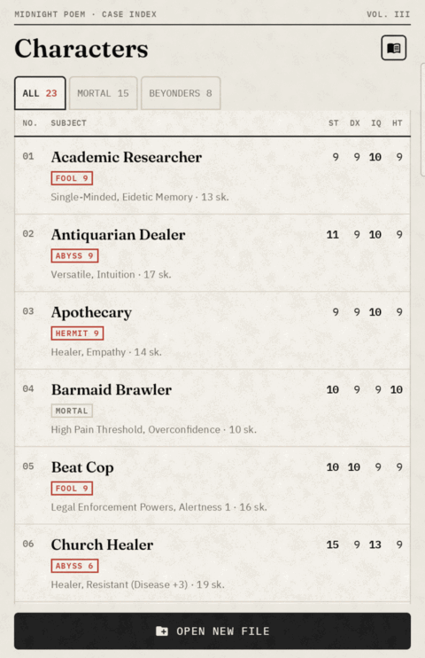
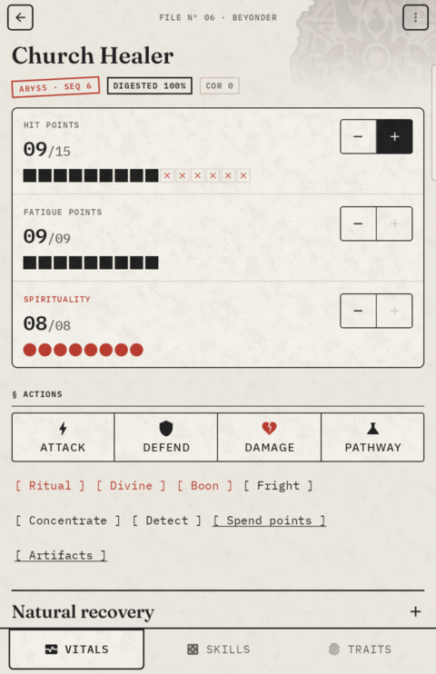
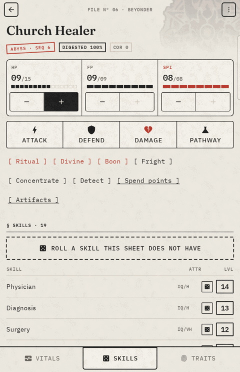
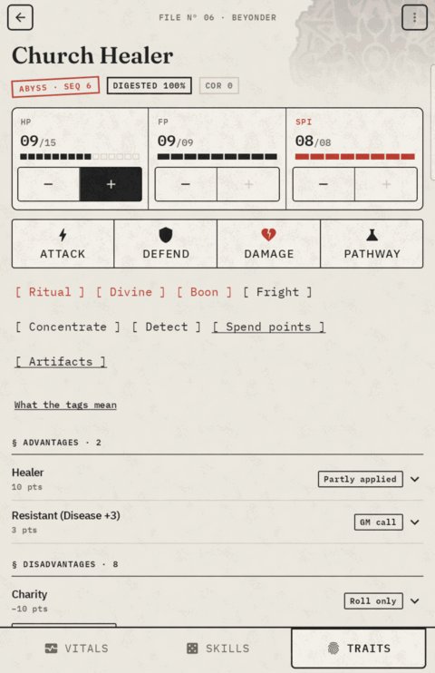
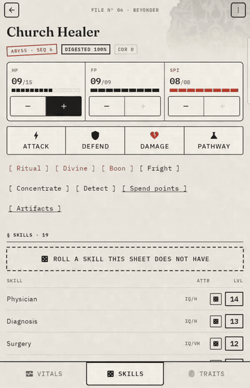
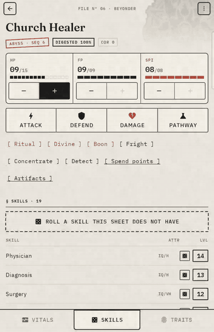
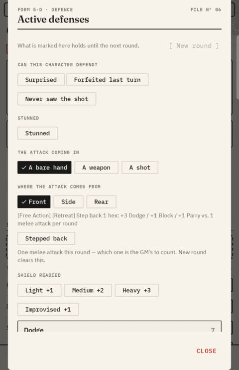
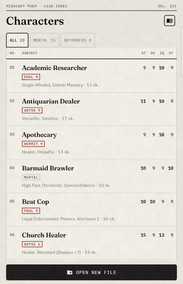
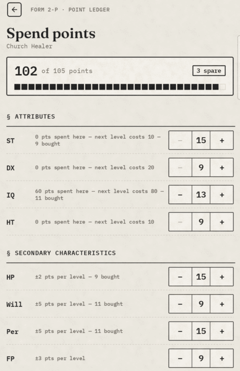

# How to play with Pathways

This guide explains each screen of the app and when to use it at the table.

The game itself is *Powered by GURPS: Pathways, Lord of the Mysteries*, by Earvin Salonoy and the Mr.Worm's LOM TTRPG Discord Server. When this guide says "the book", it means their rulebook.

The app does the arithmetic. You and the GM decide what happens in the story. If the app cannot know something, it asks you. Examples are whether you were surprised, where an attack came from, or how many times you parried this round. You tell it, and it adds up the numbers. It never hides a modifier and never makes up a rule.

## The four screens

| Screen | How to open it | What you do there |
|---|---|---|
| Character list | The app opens on it | Pick one of the 23 published characters, or make your own |
| Sheet | Tap a character | Play: roll skills, fight, cast rituals, divine |
| Pathway | **Pathway** on the sheet (**Drink a potion** before the first potion) | Drink potions, read your powers, track digestion |
| Builder | **Spend points** on the sheet | Buy attributes, skills, traits, languages and weapons against a point budget |

---

## 1. Pick a character

Tap a character to open the sheet.

Each row shows the file number, the four attributes, the first two traits and the number of skills. These are the values as you play them now, with your purchases and potions counted. The tabs above the list filter it:

- **All** shows everybody.
- **Mortal** shows characters who have not drunk a potion.
- **Beyonders** shows characters on a pathway, each with a stamp for the pathway and Sequence.

A character lost to the Rampager or to corruption shows in red.

### Make your own character

1. Tap **Open new file** at the bottom of the list.
2. Type a name.
3. Pick **Blank sheet**, or **Template** to copy a published character. Type in **Filter templates…** to find one.
4. Open the new character and tap **Spend points** to build it.

**Start from a blank sheet**, under the list, opens an empty sheet with no name.

### Glossary

The book icon next to **Characters** opens the glossary. Tap a letter to jump, or type in **look up a term**. Tap a term to read it.

### Credits

The **i** icon, next to the book icon, opens **Credits**: who wrote the rulebook this game comes from, and who owns the novel and the GURPS system.

---

## 2. The character sheet

  
  
  

From top to bottom, the sheet has these parts.

### The top bar

The top bar shows the file number and whether the character is a Beyonder. The **⋮** menu holds three items:

- **Roll log** lists each roll this character made since you opened the app, newest first. It shows the dice and the target, for example *"Fright Check 2 + 5 + 2 = 9 vs 5"*. It does not show success or failure, because a push or a table can change that after the dice. Closing the app clears the log.
- **Delete character** appears only on a character you made. It asks first. You cannot delete a published character.
- **Reset to sheet** asks first and cannot be undone. On a published character it removes everything: potions, purchases, wounds, corruption and the roll log. On your own character it keeps the build and removes only what play added: potions, wounds, corruption, study points, a boon, and traits gained in play. Use it to start over, not during play.

### The header and the pools

The header under the name shows tags for the pathway and Sequence, digestion, Corruption (CoR), and *Lost* if the character is gone.

The pool card holds HP, FP and SPI, each with **−** and **+**. **+** is dark while there is something to get back, and grey at the maximum. When a pool reaches a row of the book's table, the state and its cost appear beside the name, for example *Reeling · −1 all rolls*. Tap the pool to read the full row. SPI shows only for a Beyonder. If you scroll down, the pools stay visible as a thin line under the top bar.

### The actions

The actions come in two sizes:

- Four large buttons: **Attack**, **Defend**, **Damage** and **Pathway**.
- Smaller words in brackets, such as *[ Fright ]*. The red ones are Beyonder powers: Ritual, Divine, Spirit Vision and Boon. Ritual, Divine and Spirit Vision appear only after a potion grants them. Spirit Vision uses the pathway's own name for it, for example *Eyes of Mystery Prying* for a Hermit. **Boon** is always there.

### The bottom bar

The bottom bar switches between **Vitals**, **Skills** and **Traits**. The pools and actions stay where they are.

### Vitals

Vitals shows the secondary characteristics: Hit Points, Fatigue Points, Will, Perception, Basic Speed, Basic Move and the rest.

If some values differ from the published sheet, the card gets an *Amended* stamp. **Show amendments** shows only those rows on Vitals and Skills. **Show all values** brings the rest back. Each row shows the sheet's figure next to the one you play. If the book disagrees with the sheet, the sheet's figure is struck through in red.

**Natural recovery** is closed until you tap it. See [Healing over days](#healing-over-days).

**Does any of this hold?** appears when one of your drawbacks gives "-N to all rolls" in a situation only the GM can see. Examples are a phobia's trigger, laudanum withdrawal, or an entity nearby. Tap the line to turn it on. It then counts on every roll on every screen, and each roll names it, until you tap it again. Perceptual Splitting's line counts only on rolls based on ST, DX or HT. These lines are not saved. Closing the app clears them, and so does **Reset to sheet**. Each character keeps their own while the app is open.

### Skills

Each row is a skill and its level. Tap the row to roll. See [Roll a skill](#3-roll-a-skill).

### Traits

Traits lists each advantage and disadvantage with its price and a tag. The tag says how much of the trait the app uses:

| Tag | Meaning |
|---|---|
| *Applied* | The app counts all of it |
| *Partly applied* | The app counts some of it. Open the row to see what it leaves out. |
| *Roll only* | The app rolls the self-control roll and counts nothing else |
| *GM call* | The GM applies it |
| *Unmatched name* | The sheet spells it in a way the book's list does not match |

Tap a row to read the book's text and, for anything not counted, the reason. **What the tags mean** explains each tag. A self-control disadvantage has its own *Roll 3d6 ≤ N* chip.

A trait from a potion shows *"from the potion"* in place of its price, and it counts in every roll. The builder will not sell it to you again. A potion's Charisma adds to a level you bought, for example *"Charisma 4 — 10 pts, +2 from the potion"*. If a potion gives you a new Appearance and you also bought one, the better one counts.

### When the sheet and the book disagree

The app follows the book. If a published sheet has an error, the app shows both numbers and keeps the difference visible. Four published sheets have arithmetic errors:

- Docks Bouncer's HP
- The FP of three sheets
- Monastery Scholar's advantage total
- University Librarian's disadvantage total

The grey note on a row says what each number is. *"HP 14 · 11 from the sheet's points (sheet: 9)"* means you play 14, the sheet's own points give 11, and the sheet prints 9.

Four sheets print SPI 9 with no pathway: Apothecary, Barmaid Brawler, Docks Bouncer and Military Police. The app cannot play a Beyonder with no pathway, so these characters have SPI 0 until they drink a potion.

### Reference text

Longer rule text in a dialog sits in a dashed box that is closed until you tap it. Examples are the shield rules, the incantation, and Spirit Vision's color key. Targets, costs and refusals always stay open.

---

## 3. Roll a skill

1. On **Skills**, tap a skill. The roll dialog opens before any dice are thrown.
2. Pick the circumstances the GM called. The **Target** box changes as you pick, and the skill's own level shows struck through next to it.
3. If the GM gives a modifier that no chip names, use the **Modifier** stepper.
4. Tap **Roll**.

The result shows the degree of success, *3d6: total vs target*, the margin, and each line that changed the target.

The target already includes your level, the penalties from HP, FP, SPI and Corruption that reach this skill, and any trait that applies.

The book's critical rules apply: 3 or 4 always succeeds, and 17 or 18 always fails. A few tables have their own rules, and those win.

### Push the roll

After you see the dice, you can buy a better result:

- On a roll based on ST, DX or HT, 1 FP buys +1, up to +5.
- On a spiritual roll, 1 SPI buys +1, with no limit, but you cannot spend SPI you do not have.

The push raises the target. It does not change the dice. If you spend nothing, the roll stands. A roll based on IQ, Will or Per gets no push, so the row is not there. FP can go below 0, because the book charges 1 HP for each FP below 0.

**Ritual**, **Boon** and **Divine** offer the same push. There, the app charges it when you close the dialog. A divination that is already *Crystal clear* offers no push.

### Gear

**Gear that names this skill (not applied)** lists items from the equipment table that help this skill, for example "Magnifying glass (3s) — +1 to Search for fine details". The app does not add these. It does not track your gear, and most of them need a condition only you and the GM can judge.

If you have the item and the condition holds, pick **Good tools / equipment** (+1 to +2) in the circumstances, and choose the value. **Improvised / poor tools** (-2 to -4) is the opposite. Do not add the item's own bonus on top.

### A skill you do not have

Most skills can be tried untrained, at a default.

1. At the top of **Skills**, tap **Roll a skill this sheet does not have**.
2. Type a few letters in **Find a skill**.
3. Tap the skill. The normal roll dialog opens, for example *"Acrobatics (untrained, DX-6)"*.

The default is your attribute -4 for an Easy skill, -5 for Average and -6 for Hard. Brawling is DX-2. Versatile adds +1 to each default. With Medical Training (Informal), Physician is IQ-2, and Versatile does not add to that.

Very Hard skills and Wrestling have no default and are not listed. Divination Arts is listed only with Ritualistic Magic at 12 or more. The GM can rule that a skill cannot be tried untrained, so ask first.

For an untrained punch or weapon, use **Attack**. For an Acrobatic Dodge, use **Defend**.

---

## 4. Combat

A turn usually goes **Attack**, then **Defend**, then **Damage**.

### Attack

1. Pick the skill. The list shows your combat skills, then the ones you can use untrained.
2. Pick the weapon, the maneuver and any attack options. The dialog adds up the cost as you go: Deceptive Attack, Rapid Strike, All-Out Attack, and the FP for Extra Effort.
3. For a ranged attack, pick the conditions the GM called. The target's speed and the two Aim rows replace each other instead of adding. If a condition prints a range, such as *"Darkness or heavy fog: -3 to -9"*, a **How bad is it?** row opens. Until you pick, the app uses the mildest value.
4. Check the target at the bottom, then tap **Roll**.
5. After a hit, tap **Roll damage**.

A critical hit (3 or 4) doubles the damage rolled, before DR and wound multipliers.

The dialog does not let you pick an option the maneuver forbids. It charges FP once for each purchase.

Untrained attacks are listed under your own skills: a fist (Brawling at DX-2, Boxing at DX-5) and the weapons in the book's table, each marked like *"untrained, DX-4"*. A weapon with no skill behind it shows *"untrained parry is the GM's call"*, because the book gives no number for it.

**Shield** attacks with a shield bash. There is one chip for each shield size the book prices: *Light* thr-2 cr, *Medium* thr-1 cr, *Heavy* thr cr. The same chips appear under **Brawling** at -2.

A Warrior, Pugilist or Weapon Master uses any weapon in hand at no less than DX. The weapon's parry also starts from DX. That is the app's reading: tap *Why a master's weapon parries at DX* in Defend to read it. Put the weapon down and the skill goes back to its own level. The Warrior's *"default +2"* for a weapon used often is not applied, because the book gives no number that fits all three pathways.

### Defend

Defend has the most choices, because most of them are things only you know.

- **New round** clears the free actions, the parry count and any bought +2. It does not clear a stun. A stun ends when the recovery roll says so. That roll is on **Vitals**, under the pools, with a **Clear** button for the GM.
- **Can this character defend?** If you were surprised, used your last turn for an All-Out Attack, or never saw the shot, you get no defense. The app says which rule did it. Combat Reflexes cancels surprise only.
- **Stunned** gives -4 to every defense.
- **The attack coming in** is a bare hand, a weapon or a shot. A bare-hand parry is -3 against a weapon, and you cannot parry a shot.
- **Parry (DX, bare hands)** is the unarmed parry: Brawling or DX, divided by 2, plus 3. Every character has it. Tap *Why the bare-hand parry is DX itself* for the reason. The row is hidden if your Brawling parry is already as good.
- **Where the attack comes from** is front, side or rear. From the front, your shield's bonus counts. From the side, the book does not say, so the app shows both numbers and you decide.
- **Shield Readied** must be on for a shield to count.
- **Free actions** are Retreat (+3 Dodge, +1 Block, +1 Parry, melee only), Dive! (+3 Dodge, ranged only) and Acrobatic Dodge (roll Acrobatics, +2 or -2). Each one can be used once per round.
- **Parries already this round** counts for you. Each parry after the first is -4 (-2 for fencing weapons, -1 for a rapier). Use the stepper for a parry made somewhere else. Dodge has no such penalty.
- **Buy +2** is All-Out Defense (Increased) or Feverish Defense, on one row that you name.

A melee weapon you carry with no skill gets no parry row, and a note says so. A firearm cannot parry.

### Damage

Use **Damage** when your character takes a hit.

1. Under **The number above is**, pick what you will type. **Injury** (the default) is the final injury. If you pick a damage type such as **cr**, **cut**, **imp** or **pi**, you type the damage that got past DR, and the app applies the multiplier.
2. If you know the hit location, pick it under **Where it landed**. The app applies that multiplier too and rounds down, for example *5 cut past DR ×1.5 = 7 injury*.
3. Under **Pool**, pick HP, FP or SPI. On FP or SPI the damage type still multiplies, but the location does not, and DR never applies.
4. Tap **Apply** to take the injury off that pool. **Cancel** closes the dialog without applying the injury.

The dialog tells you if the hit is a major wound (more than half your HP). It then offers the HT roll from that table, and the sheet keeps track of the shock.

### Concentrate and Fright

**Concentrate** rolls the focus that some actions need.

**Fright** rolls the Fright Check, then the effect table.

1. Pick the kind of fright and what was seen. Each row shows its modifier from the book.
2. Adjust **Modifier** if the GM rules it worse or milder.
3. Tap **Roll**.

On 13 to 15 you gain a quirk. Name it and tap **Record the quirk**. It is saved as a disadvantage at 0 points. On 16 to 21 or 22 to 23 you gain a full disadvantage. Buy it in **Spend points** and tick **Gained in play**.

Three of the nine result bands give a recovery roll, and the dialog offers it. The other six give none. The *12* band also works out how long the effect lasts, for example *14 sec (25 − HT 11)*.

---

## 5. Beyonder play

### Drink a potion

Tap **Pathway**. A mortal sees **Drink a potion** and picks a pathway from the grid. A Beyonder opens on the potion they drank. The four Sequences sit in a row at the top. Tap one to read it.

- **Drink this potion** gives a mortal the Sequence 9 potion of the pathway they picked.
- **Drink and roll** drinks the next potion of your pathway and makes the Potion Consumption Roll. The line under the button shows the target, the cost of drinking before full digestion, and a warning if the potion would end the character even on a success. This roll has its own critical rules: 1 always fails and 19 always succeeds.
- **[ Another pathway ]** goes back to the grid.
- **Reroll the PCR** replaces **Drink and roll** after a failed roll, if the character has Luck, Beckoning Luck (and not Fate Debt), or the Wheel of Fortune rerolls at Sequence 7 or deeper. The app does not count how many rerolls you have left.

You drink one potion at a time, in order. A mortal can drink only Sequence 9, and a Beyonder only the next Sequence of their own pathway.

After the first potion, the screen has two tabs.

**Potion** shows what the Sequence grants: attribute gains, skills with their levels, advantages, disadvantages and abilities. Each ability is a row with a tag such as **1 SPI** or **Passive**. Tap a row to read it, or tap **Open all**. On a potion you drank, an ability with a fixed SPI cost has a **Spend N SPI** button. It is grey when you do not have enough SPI. An ability whose cost the GM sets has no button.

**Digestion & corruption** holds the two trackers. Log a session of acting with one tap. For example, **Good +10-15%** adds 10%, and **+5%** adds more if the GM rules it. **None** leaves it for the GM to lower. Under the CoR stepper, **From ritual work** lists the four steps of ritual corruption (3, 5, 8 and 10 CoR), and the ones you reached turn red. **What raises corruption** lists what costs CoR.

What a potion gives you costs no points. The app saves only your pathway, Sequence and digestion, and works out the gains from them. A potion that raises DX also raises each DX skill you bought.

A Hanged Man picks one of three drawbacks at Sequence 9. On the **Potion** tab, tap its chip in the Drawbacks card. You can change it later. A drawback you bought in the builder shows *bought*, and you must sell it first.

### Ritual

1. Pick the ritual's weight (Light, Moderate, Heavy or Major), its fuel, your preparation, the language and the link to the target.
2. Add the power sources: HP paid as fuel, assistants (+1 each, up to +3), the GM's sacrifice value (-40 to +40), and an invocation.
3. Read the target and the SPI cost at the bottom. The Corruption penalty is already in the target.
4. Tap **Cast**. If you do not have enough SPI, or the book forbids the language, **Cast** is grey and the reason shows in red.

Quick and Full preparation use different tables. The dialog lists the mystical languages the character bought, then any from a potion. It does not pick one for you.

Some cells print a range, such as *Good +1 to +2* or *Strong +2 to +3*. Picking one opens a row headed **The book prints … — the GM picks:**. Until you pick, the roll uses the value nearer zero.

#### Invocation

Pick *Invocation* to borrow an entity's power. The GM sets the bonus from +1 to +5 with the **Invocation** stepper. For an orthodox deity whose domain matches the request, with the caster in good standing, tap *Orthodox deity, in good standing*: the bonus is then +2. *Personal SPI* adds nothing.

A failure rolls on the failure table and a critical on its own table. You can push both. A roll of 17 or 18 cannot be pushed, because that result comes from the dice and not the margin.

### Divine

1. Pick the method and the difficulty.
2. Add the modifiers the GM allows. If a row prints a range, a second row of chips opens so you can pick inside it.
3. Tap **Roll**. The clarity of the answer comes from the result.

*"Previous divination about the same subject"* is -2 for each repeat, so you pick x1 to x4.

Divining a Beyonder stronger than you is harder. At the top of the ladder, only a critical success works, and then no push is offered, because a push cannot change the dice.

With Ritualistic Magic at 12 or more, you can divine at that skill -2. The app uses it when it is better than your Divination Arts, and says *"Defaulted from"* under the title.

### Boon

Boon is a prayer to a patron for a gift. It needs Ritualistic Magic (buy it in **Spend points**) and 4 SPI of fuel.

1. Pick the patron's pathway. You do not pick the Sequence: the first prayer asks for the first one the book lists, and each later prayer asks for the next one.
2. Pick the sacrifice, the ritual's quality, and 4 to 6 SPI of fuel. You can pay any of it in HP, at 2 HP for 1 SPI. This is how a mortal with no SPI prays.
3. Pick the **Mystical language**. *Accented* is -2. *Broken* forbids the prayer.
4. Tap **Pray**. The fuel is spent whether or not the boon is granted.

A granted boon is saved when you close the dialog. Its gains stay on the sheet next to any potions, and the header shows *Boon · name · Seq N*. Some of its traits count in rolls, marked *"from the boon"*. The GM handles the rest. The book lists nothing past Sequence 8, so you cannot pray again after that.

### Spirit Vision and Detect

**Spirit Vision** (the red chip, under your pathway's name for it) rolls the look into the spirit world. **Detect** rolls the detection checks, and applies a target's anti-divination counters. With Acute Vision, a chip offers *+2 to Vision rolls*. Tap it if the GM says it helps. A look that leaves your SPI at a third of its maximum or less gets *Spiritual Attrition -3*. A Light Sleeper gets +4 on Perception rolls while asleep.

---

## 6. Build and edit

**Spend points** opens the builder. The budget box stays at the top: points spent, the budget, and what is left (or how far over, in red).

### Attributes and secondary characteristics

Use **−** and **+** on each row. The large number is the one you play, with potions counted. The small line shows what you bought. Prices and the budget use the bought number only, because potion gains are free. Spirituality, CoR and Digestion have no stepper, because the book gives them no price.

### Skills

Tap **Add a skill** and use **Search** to find one. On a bought skill, **+** and **−** step one level at a time (1, 2, 4, 8 points and so on).

### Study

Each skill row has a tag that shows what downtime study costs for the next level, for example *24 hrs + 16s · 2 CP → 10*. A dashed tag means study is not possible. Tap the row to read why. **Study by** picks *With a Tutor* or *Self-Study*. When downtime ends, add each study point with **+** next to *study CP*. Study points raise the skill but do not use the budget. The GM limits study to two skills per downtime.

### Wealth and Appearance

Tap **Change** on the row. A new level replaces the old one.

### Languages

Tap **Add or change**. Pick a language, a level and a form. *Spoken + Written* is the full price, and *Spoken only* or *Written only* costs half. Language Talent halves the price. Multilingual makes the first two common languages at Native in both forms free. Dead Language Fluency does the same for the first of Ancient Hermes or Ancient Feysac. **Give back** removes a language. The penalty to language-dependent skills is the GM's call, because the book does not say which skills those are. A language from a trait or a potion is not listed here, so do not buy it again.

### Weapons

Tap **Carry a weapon** to pick from the nine weapons in chapter 8. Weapons cost no points. Each weapon you carry adds a `Parry (name)` row to **Defend**, if the app can work one out.

### Traits

Tap **Add a trait** and use **Search**. Tapping a row opens its text. **Buy** inside the row buys it. A trait with a range of costs or a "(specify)" name has **Choose…** in place of **Buy**, so you can name it and set its price.

A bought Charmed Object has a **Choose skill** button. After you choose, rolls and attacks with that skill offer a *+1 to one specific skill when used* chip. Parries, Acrobatic Dodge, rituals, divination and boons do not get the +1.

Your changes are saved for each character and stay after a restart.

---

## Healing over days

While a character is hurt, **Vitals** has **Natural recovery**.

1. When the GM says a day of rest has passed, tap **Roll HT N — a day of rest and food**.
2. Read the result line. It quotes the book's table.
3. Add the HP yourself with **+** on the HP pool. The GM decides which row applies.
4. Tap **Another day** to get ready for the next roll.

**The book's rows** shows the table. Use the **−1 / +1** stepper for anything else that changes the roll. A Fast Healer gets one more HP on a success.

The app does not heal with First Aid or Physician. Roll them as skills, then add the HP with **+**. The Healing advantage and Regeneration are not offered.

---

## Where the book is unclear

In a few places the book does not settle a rule. The app picks a reading, and some dialogs explain it in a closed note. If you look these up in the book, you will not find the exact answer there:

- A critical hit doubles the rolled damage, before DR and the wound multipliers.
- The bare-hand parry takes the same -3 against a weapon as Brawling does.
- A Warrior, Pugilist or Weapon Master parries with a weapon at no less than DX.
- Injury after a multiplier is rounded down.
- Each assistant gives +1, the caster counting as the first participant.
- An orthodox deity's +2 is the invocation bonus, not +2 on top of it.
- Dead Language Fluency's free language is the owner's reading. The book names no level, price or list.
- A potion's granted skill levels stay fixed when a later potion raises the attribute. A skill you bought rises with it.

The GM can rule differently. Use the **Modifier** stepper for the difference.

---

## What the app leaves to you and the GM

- What only you can see: surprise, facing, whether you saw the shot, and how many parries you made somewhere else.
- Time: there is no initiative, map or turn counter. The only round is the one on **Defend**. FP recovery, stun length, reload time and the days of healing are yours to count.
- Gaps in the book: where the book prints nothing, the app says so and leaves it to the GM.
- Your gear and money: the app tracks weapons carried and nothing else.
- The number of Luck rerolls left.

---

## If a number looks wrong

1. Look at what the dialog says it applied. Each roll lists its modifiers.
2. Look it up in the book. The book is the authority.
3. If the app matches the book, then the sheet has the error. That is worth noting, but do not change the sheet to hide it.
